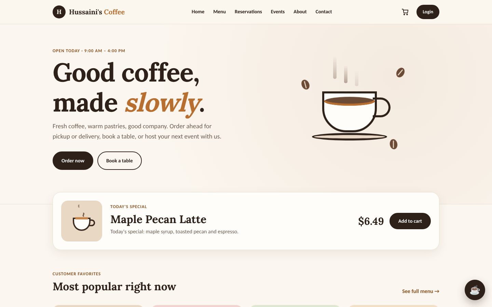
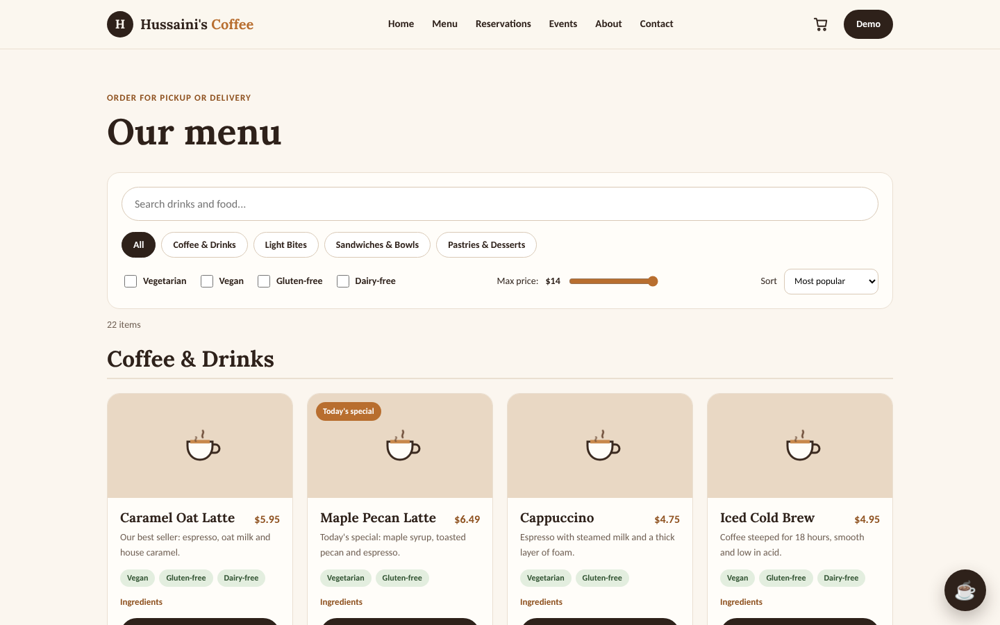
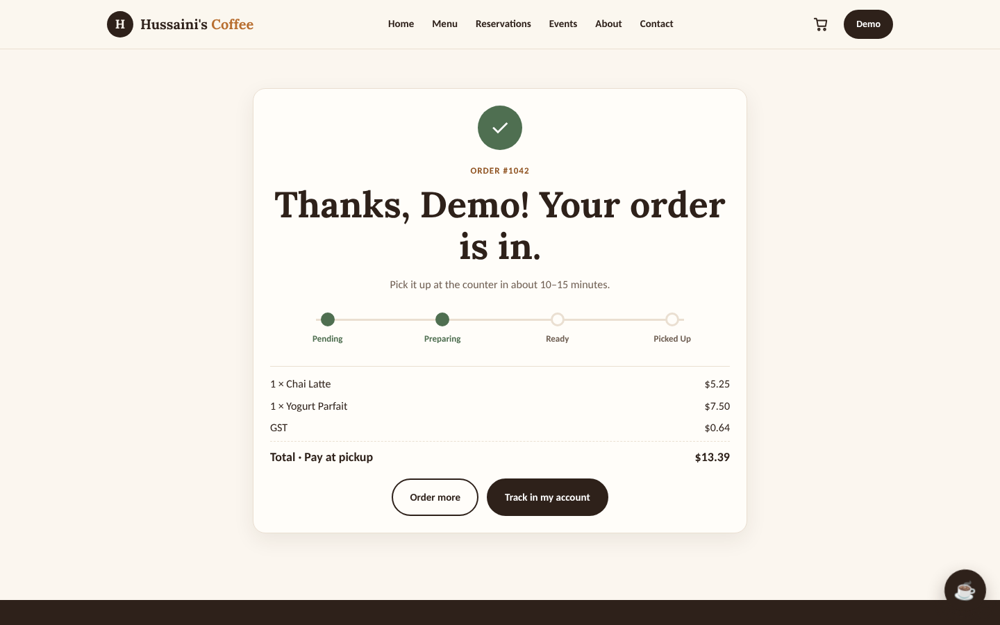
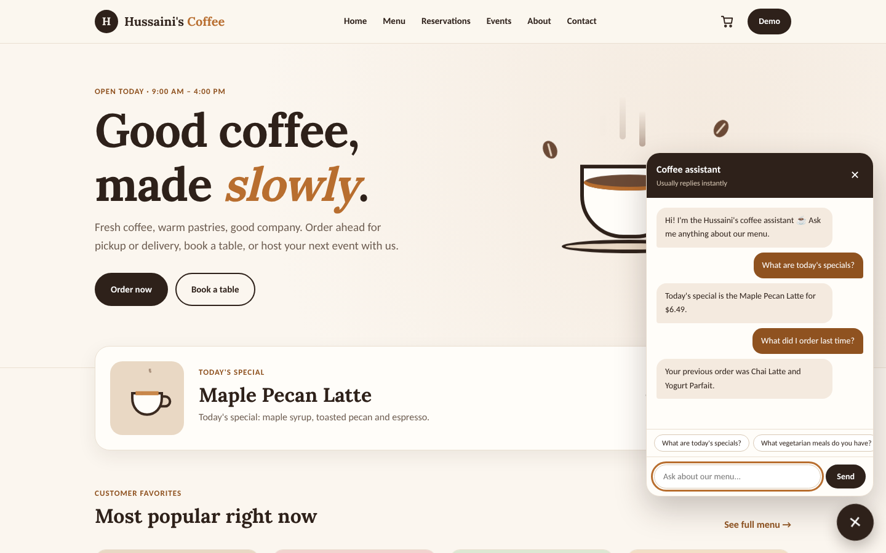
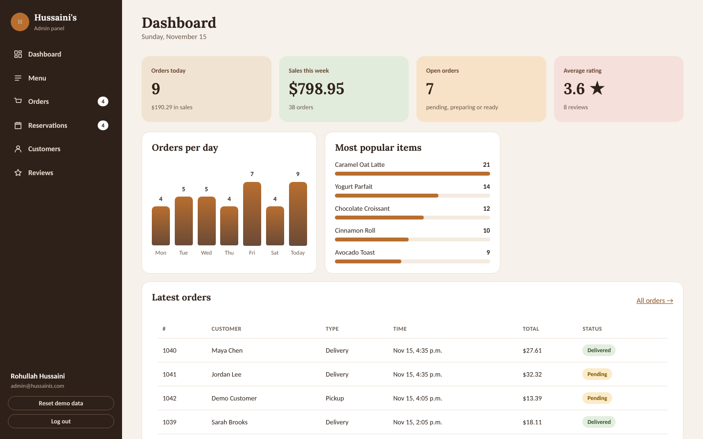
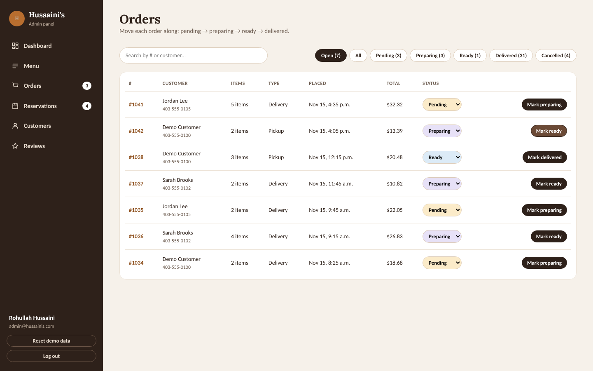
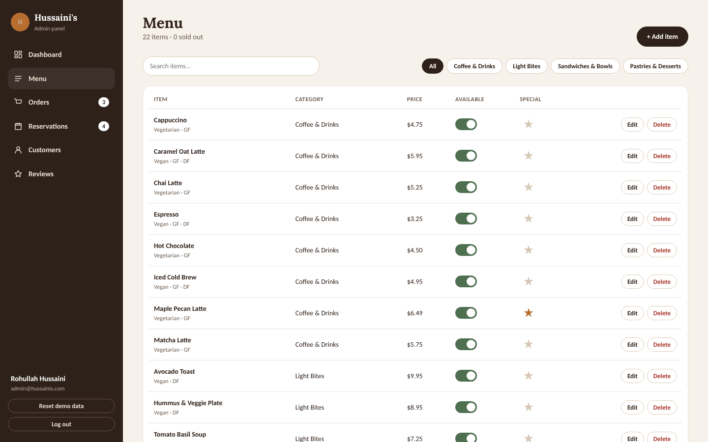
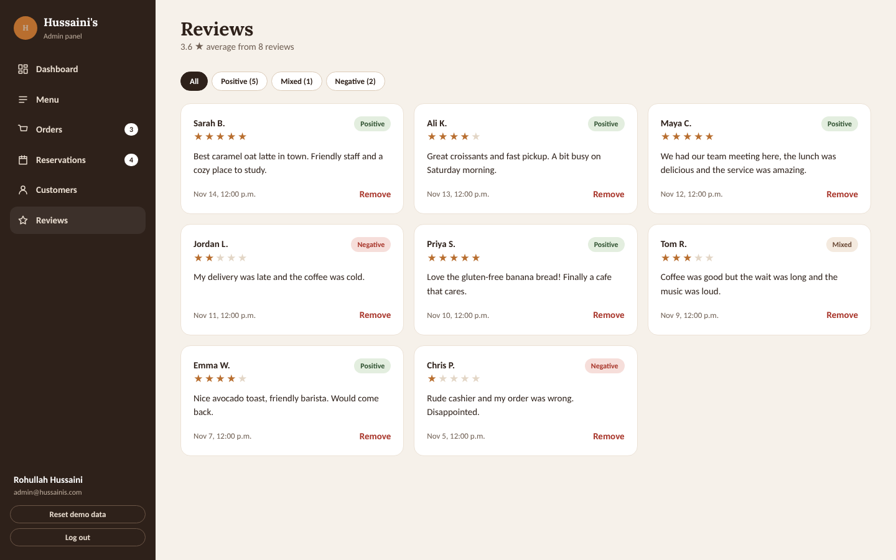

# Hussaini's Coffee Shop

Smart Restaurant Management System — Assignment 1 (React Frontend)

This is our coffee shop web app built with React. We split it into two parts: a main website where customers can browse the menu, order food or drinks, book tables and events, and chat with a helper bot, and an admin panel to manage orders, menu items, bookings, and reviews.



## Team

- **Rohullah Hussaini** — Customer website (`client/`)
- **Mohammad Abu Hantash** — Admin website (`admin/`)

## Customer Website (Rohullah Hussaini)

- **Menu:** Browse 4 categories, search by name, filter by diet or max price, and sort items.
- **Cart & Checkout:** Order for pickup or delivery (calculates GST and delivery fee automatically).
- **Order Tracker:** Live status updates (`pending` → `preparing` → `ready` → `delivered`).
- **Table Reservations:** Prevents double bookings and only allows times during open hours.
- **Event Booking:** Book space for birthdays, team meetings, or workshops.
- **Account:** View past orders, edit or cancel bookings, and save preferences.
- **AI Assistant:** Answers common shop questions and remembers your last order.

| Menu | Order Tracker | AI Assistant |
|---|---|---|
|  |  |  |

## Admin Website (Mohammad Abu Hantash)

- **Login:** Protected routes for admin access only.
- **Dashboard:** Overview of today's orders, weekly sales, sales chart, and popular items.
- **Menu Manager:** Add, edit, or delete items, mark things sold out, and set today's special.
- **Orders:** Search, filter, and update order statuses.
- **Reservations:** Approve, complete, or cancel table and event bookings.
- **Customers & Reviews:** View customer info and check reviews with basic keyword sentiment tags.

| Dashboard | Orders |
|---|---|
|  |  |
| **Menu** | **Reviews** |
|  |  |

## How to Run It

Make sure you have Node.js installed. Open two separate terminals and start both apps:

```bash
# Terminal 1 - Customer website
cd client
npm install
npm run dev